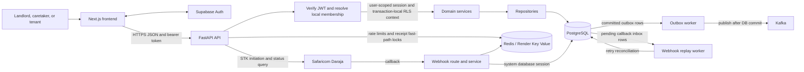
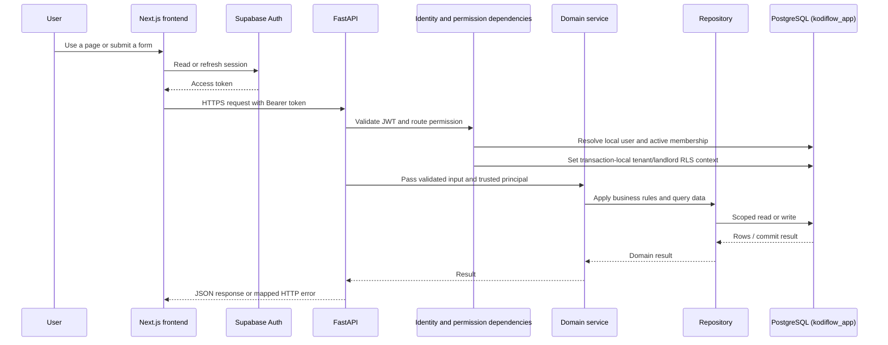
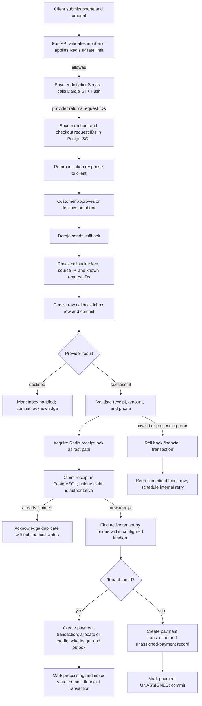
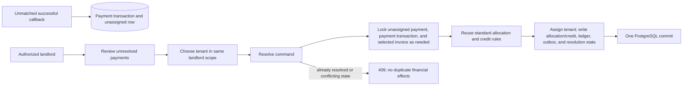
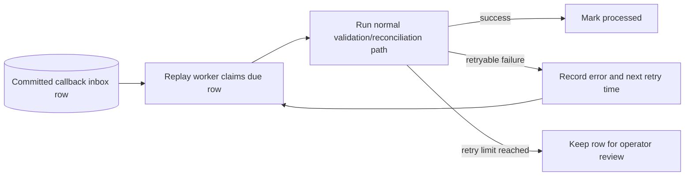

# KodiLedger Application Workflows

This document describes how data moves through the implemented application: from the Next.js client and identity provider, through FastAPI routes and services, into PostgreSQL, and then through the callback-replay and outbox workers. It focuses on the current backend behavior; future consumers and unfinished API routes are identified as such.

See [API.md](API.md) for request/response contracts, [service.md](service.md) for the responsibilities of `app/services/` modules, [ARCHITECTURE.md](ARCHITECTURE.md) for system structure, and [SECURITY.md](SECURITY.md) for authentication and row-level security details.

## 1. System flow at a glance



The browser obtains a session from Supabase Auth. The frontend API client sends the access token as a Bearer token to protected API routes. The backend verifies the JWT using its configured issuer, audience, JWKS URL, and asymmetric signing algorithm; it then resolves the identity to one active KodiLedger user and membership. The backend derives role and tenant/landlord scope from that membership rather than trusting scope values supplied by the client.

Business routes use the `kodiflow_app` PostgreSQL login and row-level security (RLS). Trusted callback and worker flows use `kodiflow_system`. PostgreSQL is authoritative for payment, invoice, ledger, allocation, credit, and outbox records. Redis is a short-lived coordination/rate-limit layer; it is not the financial source of truth.

## 2. Normal authenticated request pipeline



For reads, the repository applies ownership filters and PostgreSQL RLS; the response contains only the fields defined by its response schema. For writes, the route/service validates ownership and consistency, writes through the current database session, and commits before returning success. A failed mutation is rolled back. Read isolation is per database statement; a later HTTP request may see newer committed data.

### Examples of the same pipeline

- **Unit creation:** validate landlord permission → verify the parent property is in scope → insert the unit and update the property's `total_units` within one PostgreSQL transaction → return the created unit.
- **Tenant creation:** validate landlord permission and unit scope → insert the tenant row → return the created tenant.
- **Invoice creation:** validate landlord permission → verify that the tenant and unit belong together under the landlord → lock the tenant to coordinate invoice creation with payment allocation → insert the invoice → apply available tenant credits FIFO → commit the invoice and credit applications together.
- **Financial reads:** payment history, allocation/credit details, invoice data, and ledger queries use their caller's authenticated scope and do not alter financial state.

## 3. M-Pesa payment and callback pipeline

STK initiation and payment confirmation are separate stages. A successful response from Daraja means the request was initiated; the callback is the source of the confirmed result.



### Callback stages in more detail

1. **Initiation:** `POST /api/v1/payments/stk-push` validates the request and applies an IP rate limit. It calls Daraja using the trusted system database dependency. If the provider returns merchant and checkout request IDs, KodiLedger records them in the STK request table and commits that record. This route has no client idempotency key and does not create a payment transaction, allocation, ledger row, or confirmed payment.
2. **Callback guard:** `POST /api/v1/webhooks/mpesa` checks configured callback controls and correlates the merchant/checkout IDs with a recorded STK request. An unmatched callback is rejected before it enters the durable inbox.
3. **Inbox durability:** the raw callback payload is inserted and committed before financial processing. This preserves the received provider message if the process fails during reconciliation.
4. **Provider decline:** a non-success provider result is marked handled and committed without creating a successful payment transaction.
5. **Duplicate protection:** successful callbacks use Redis for a fast-path receipt lock. PostgreSQL's unique payment-processing claim remains authoritative. A repeated receipt is acknowledged as a duplicate and does not repeat the financial write set.
6. **Matched payment:** KodiLedger normalizes the payment, locks the tenant/payment/invoice rows in a consistent order, allocates funds to the oldest unpaid invoice, and records remaining funds as a credit where needed. It records a ledger credit and an outbox event in the same transaction, updates processing and inbox status, and commits the whole financial write set together.
7. **Unmatched tenant:** KodiLedger records the normalized payment and an unassigned-payment record with `UNASSIGNED` processing state. It does not create the matched-payment ledger/outbox effects until an authorized landlord resolves the payment.
8. **Failure and replay:** if financial processing fails, that transaction rolls back. The already-committed inbox record remains and is scheduled for retry; the Redis lock is released when possible. The HTTP callback response can still be HTTP 200 with `ResultCode: 1`, so callers must not treat HTTP success alone as reconciliation success.

## 4. Unassigned payment resolution

The landlord reviews `GET /api/v1/unassigned-payments` and submits `POST /api/v1/unassigned-payments/{payment_id}/resolve` with an eligible same-landlord tenant ID. The client does not provide the amount, invoice, unit, ledger values, or payment status.



Resolution is atomic within PostgreSQL. It may allocate to an invoice or leave some/all funds as a tenant credit. A successful command is not replayed as the same success response; repeating it after resolution returns a conflict rather than applying the funds again.

## 5. Webhook replay and event publishing pipelines

### Webhook replay worker

The standalone `python -m app.workers.webhook_replay` process polls the callback inbox approximately every five seconds. It claims eligible pending rows, recovers stale claims, and calls the same webhook/reconciliation service with the persisted callback data. Retry timing uses capped backoff; rows that reach the configured retry limit remain stored for operator review rather than being silently discarded.



### Transactional outbox worker

Matched callback reconciliation and unassigned-payment resolution insert the outbox event in the same PostgreSQL transaction as their financial effects. The standalone `python -m app.workers.outbox` process claims pending events with database row locking, commits the claim, publishes to Kafka, then records success or retry in a separate database transaction.

```mermaid
sequenceDiagram
    participant T as Financial transaction
    participant P as PostgreSQL outbox
    participant W as Outbox worker
    participant K as Kafka publisher

    T->>P: Insert payment-processed event with ledger/payment effects
    T->>P: Commit
    W->>P: Claim pending batch and release row locks
    W->>K: Publish batch after commit
    K-->>W: Per-event success or failure
    W->>P: Mark published or schedule retry; commit
```

This is an at-least-once delivery pipeline. If Kafka accepts an event but the worker fails before marking it published, the event may be sent again. The outbox gives atomicity between financial changes and event creation, not between PostgreSQL and Kafka. Downstream consumers must deduplicate. No Kafka consumer is currently implemented in this repository; notifications and analytics consumers remain future work.

## 6. Data stores and transaction boundaries

| Component | What it holds or does | Authority and boundary |
|---|---|---|
| PostgreSQL | Users/memberships, properties, units, tenants, invoices, payments, processing claims, allocations, credits, ledger entries, callback inbox, and outbox | Authoritative financial and application state. Each explicit PostgreSQL transaction is atomic; callback inbox persistence is deliberately committed separately from later financial reconciliation. |
| Redis / Render Key Value | STK IP rate limits and short-lived receipt locks | Coordination only. Redis failure must not replace PostgreSQL constraints/claims as the correctness mechanism. |
| Safaricom Daraja | STK initiation and provider status/callbacks | External payment system. A PostgreSQL rollback cannot undo an STK request or a completed external payment. |
| Kafka | Published outbox events | External event transport, published after PostgreSQL commit. Delivery may repeat. |
| Supabase Auth | Frontend session and token issuance | Identity provider; KodiLedger still resolves the verified identity to local membership and permissions. |

The callback's financial records are ACID within PostgreSQL, but the overall workflow across PostgreSQL, Redis, Safaricom, and Kafka is not a single distributed ACID transaction. See [API.md](API.md#21-financial-api-invariants) for endpoint-by-endpoint transaction classification.
